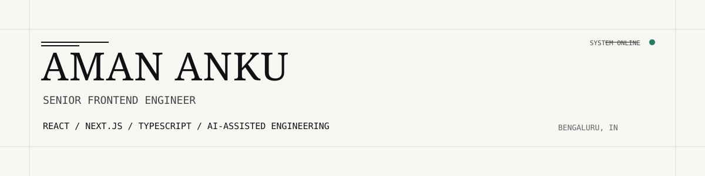
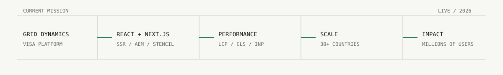
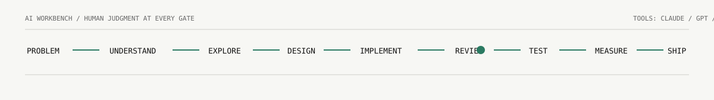
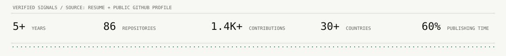
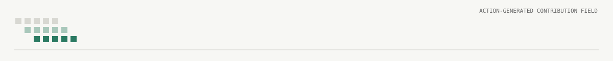

  <picture>
    <source media="(prefers-color-scheme: dark)" srcset="./assets/hero-dark.svg" />
    <source media="(prefers-color-scheme: light)" srcset="./assets/hero.svg" />
    
  </picture>

  <a href="https://amananku26.github.io">Portfolio</a> &nbsp; / &nbsp;
  <a href="https://www.linkedin.com/in/amanAnku26">LinkedIn</a> &nbsp; / &nbsp;
  <a href="mailto:amankumaranku@gmail.com">Email</a> &nbsp; / &nbsp;
  <a href="https://github.com/amananku26?tab=repositories">Repositories</a>

 

## The profile

I am a Senior Frontend Engineer based in Bengaluru, India. I build production interfaces with React, Next.js, and TypeScript, with a particular interest in the systems around the UI: rendering strategy, performance, accessibility, design systems, and developer experience.

My current direction is AI-assisted engineering: using Claude, GPT, GitHub Copilot, Cursor, and MCP to explore and implement faster, while keeping architecture, review, testing, and measurement human-led.

## Current mission

  <picture>
    <source media="(prefers-color-scheme: dark)" srcset="./assets/mission-dark.svg" />
    <source media="(prefers-color-scheme: light)" srcset="./assets/mission.svg" />
    
  </picture>

At Grid Dynamics, I work on a global VISA enterprise platform serving millions of users across 30+ countries. My work includes scalable React and TypeScript components, Next.js, SSR, Headless CMS and AEM, Stencil, Core Web Vitals, Lighthouse, accessibility, WCAG, code reviews, and mentoring.

## Engineering systems

| Layer | Working set |
| --- | --- |
| Product surface | React, Next.js, TypeScript, JavaScript, i18n |
| Architecture | SSR, SSG, microfrontends, reusable components, design systems |
| Content and data | Headless CMS, AEM, REST APIs, GraphQL, Redux |
| Quality | Jest, React Testing Library, Cypress, TDD, WCAG |
| Delivery | Docker, AWS, CI/CD, Lighthouse, LCP, CLS, INP |

## AI workbench

  <picture>
    <source media="(prefers-color-scheme: dark)" srcset="./assets/ai-workbench-dark.svg" />
    <source media="(prefers-color-scheme: light)" srcset="./assets/ai-workbench.svg" />
    
  </picture>

The loop matters more than the tool: **problem -> understand -> explore with AI -> design -> implement -> human review -> test -> measure -> ship**.

## Selected public work

### `agentic-ai`
An interactive Streamlit agent system built around a Planner, Executor, Synthesizer, and Critic. It retrieves evidence from a FAISS vector store and the web, then iteratively refines answers.

[Open the repository](https://github.com/amananku26/agentic-ai)

### `genai_project1`
A Python project for synthetic HR data generation and query utilities for demos and testing.

[Open the repository](https://github.com/amananku26/genai_project1)

### More of the archive

The wider repository history includes a React portfolio, React and Next.js experiments, i18n examples, testing work, and frontend prototypes.

[Browse all repositories](https://github.com/amananku26?tab=repositories)

## Signal

  <picture>
    <source media="(prefers-color-scheme: dark)" srcset="./assets/signal-dark.svg" />
    <source media="(prefers-color-scheme: light)" srcset="./assets/signal.svg" />
    
  </picture>

The figures above are a compact record of the verified context behind this profile: 5+ years of professional experience, approximately 86 repositories, 1.4K+ contributions, production work spanning 30+ countries and millions of users, and a 60% reduction in content publishing time from previous work.

## Contribution field

Generated daily by GitHub Actions from the public contribution graph. It is a visual activity signal, not a measure of engineering ability.

  <picture>
    <source media="(prefers-color-scheme: dark)" srcset="./assets/github-snake-dark.svg" />
    <source media="(prefers-color-scheme: light)" srcset="./assets/github-snake.svg" />
    
  </picture>

## Outside the system

I like long motorcycle rides, guitar, and following technical rabbit holes until the shape of a problem becomes clear enough to build.

  <a href="https://amananku26.github.io">Build with me</a> &nbsp; / &nbsp;
  <a href="mailto:amankumaranku@gmail.com">amankumaranku@gmail.com</a>

Profile assets are authored locally. Contribution art is the only generated external-style surface; if the workflow has not run yet, the checked-in monochrome fallback remains in place.
